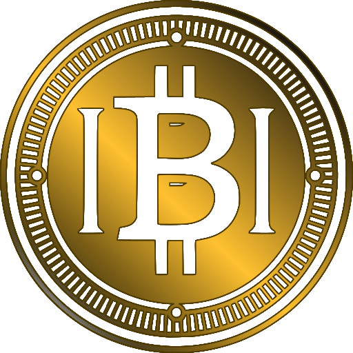

<p align="center">
  <a href="https://www.ibiticoin.com">
    
  </a>
</p>

<h1 align="center">IBITIcoin Contracts</h1>

<p align="center">
  Smart contracts and deployment tooling for <b>IBITIcoin (IBITI)</b> on <b>BNB Smart Chain (BEP-20)</b>.
</p>

<p align="center">
  <a href="https://www.ibiticoin.com">Website</a> •
  <a href="https://www.ibiticoin.com/whitepaper.html">Whitepaper</a> •
  <a href="https://t.me/IBITIcoin_chat">Telegram</a> •
  <a href="https://x.com/ibiticoin">X</a> •
  <a href="https://www.facebook.com/groups/ibiticoin">Facebook Group</a> •
  <a href="https://www.linkedin.com/in/ibiticoin">LinkedIn</a>
</p>

---

## Overview

This repository contains the Solidity contracts, Hardhat scripts and tests used for IBITIcoin.
It is intended for developers, integrators, and auditors who want to review the code and reproduce the build.

> ⚠️ Disclaimer: This repository is provided “as is” for transparency and review.
> Nothing here is financial advice. Always do your own research and testing.

---

## Token

- **Name:** IBITIcoin
- **Symbol:** IBITI
- **Standard:** BEP-20
- **Network:** BNB Smart Chain (chainId 56)
- **Decimals:** 8
- **Total supply:** 100,000,000 IBITI, fixed at deployment

The token has no owner, no minting, no pause, no fees, no blacklist, no proxy and no upgrade path.
Holders can burn their own tokens.

### Mainnet addresses

| Contract | Address |
|---|---|
| IBITI token | [`0x71b552D3503fe20610aaA470A96E1838fae8381A`](https://bscscan.com/address/0x71b552D3503fe20610aaA470A96E1838fae8381A) |
| Team vesting | [`0xC4bdF5b6d7688a7d5457A194ac1210ec34003604`](https://bscscan.com/address/0xC4bdF5b6d7688a7d5457A194ac1210ec34003604) |
| Website sale | [`0x42924EE213eF1943BE655c2C535FB72F52C64781`](https://bscscan.com/address/0x42924EE213eF1943BE655c2C535FB72F52C64781) |
| Staking | [`0x509e0CeaA5840304D2f33bC43e66Fa27ECDc0348`](https://bscscan.com/address/0x509e0CeaA5840304D2f33bC43e66Fa27ECDc0348) |
| NFT collection | [`0x771Ad1baef4b7321F10F2549b6C1Bc34106120Ed`](https://bscscan.com/address/0x771Ad1baef4b7321F10F2549b6C1Bc34106120Ed) |
| NFT sale | [`0x92CFE8c739e6A1bE9bbc2971E5A7ba6747fccA1f`](https://bscscan.com/address/0x92CFE8c739e6A1bE9bbc2971E5A7ba6747fccA1f) |

Other modules are separate contracts. They are added here as they are deployed.

### Distribution at deployment

| Share | IBITI | Address |
|---|---|---|
| Liquidity and exchanges | 70,000,000 | `0xC00dC8E3F4647AAa4791AE58901eDDFE6095adA5` |
| Marketing and reserve | 19,999,895.9835292 | `0x9d8dd8B2CFF7A17967fA0eF19eD5C0b3EBeFDe41` |
| Team vesting contract | 10,000,000 | `0xC4bdF5b6d7688a7d5457A194ac1210ec34003604` |
| Holders of the previous token | 104.0164708 | 4 addresses, see `config/tokenomics.bsc.json` |

The 1,000,000 IBITI on the website sale contract and the 1,000,000 IBITI staking reward pool came from marketing and reserve.

---

## Contracts

### `IBITI.sol`

Standard ERC-20 with burn. The whole supply is created once in the constructor and sent straight to the recipients.

### `IBITIVesting.sol`

Holds the team share of 10,000,000 IBITI on one fixed schedule:

- 20% at start
- 30% after 180 days
- 50% linearly over 180 days after 1095 days

Only the owner can pay out, only to addresses the owner has listed, and only what the schedule has unlocked.
Ownership cannot be renounced, and transferring it takes two steps.

### `IBITIPromoSale.sol`

Website sale of IBITI for USDT at a fixed price. Values set at deployment:

| Parameter | Value |
|---|---|
| Price | $0.10 per IBITI |
| Bonus | 10% |
| Referral reward | 1 IBITI, once per buyer |
| Purchase limits | 10 to 100 USDT |

USDT goes to the reserve wallet in the same transaction and does not stay on the contract.
IBITI is paid only from the contract's own balance, which is funded by a plain transfer, so no wallet approval is needed.
The bonus and referral reward cannot be changed. While the sale is paused, the owner can change the limits, set the price
between $0.001 and $10, and withdraw unsold IBITI.

### `IBITIStaking.sol`

Lock IBITI for 1 to 12 months for a reward known in advance, from 1% to 30% of the stake. The minimum stake is 100 IBITI.

| When you withdraw | You receive |
|---|---|
| Before the term ends | Stake minus a penalty equal to the reward percentage, no reward, no NFT |
| Within 30 days after the term | Stake, reward and NFTs, or renew with a new amount and term |
| Later | Stake only, with no time limit; the reward and NFTs are lost |

Rewards come from a pool on the contract, funded by plain transfers. The reward is reserved when you stake, so one user's stake never pays another user's reward. When the pool runs out, new stakes are refused.
Penalties and lost rewards stay in the pool, and the owner can withdraw its free part. Stakes and reserved rewards are out of the owner's reach. A pause stops new stakes and renewals; withdrawing always stays open.
Reward NFTs come from `IBITICollection`, which the staking contract binds once. A failed NFT mint never blocks the tokens.

### `IBITICollection.sol`

The Path of Humanity: 11 cards from the story told in our book. An NFT stays with its holder for good: there is no expiry, no burn and no pause, and the owner cannot take or freeze it.
Each card has its own edition, which can be lowered but never raised. New cards can be added later. It is a collectible: it gives no discount, no income and no share in the project.
A resale on a marketplace that honours ERC-2981 pays 5% to the reserve wallet; the owner can change this, up to 10%.

A stake of 3, 6, 9 or 12 months held to the end earns 2 cards as a bonus: Awakening for 3 months, The First Gods and Kings for 6, Enlightenment for 9, The Age of Darkness and Faith for 12. They come out of the same edition as the cards on sale and can be kept or sold. If the edition has run out, the staking contract pays the tokens without the NFT.

### `IBITINFTSale.sol`

Sale of the cards for USDT at any time, while the edition lasts. USDT goes straight to the reserve wallet and never stays on the contract.
A buyer passes the price they saw, so a purchase at a different price is rejected. The sale is a separate contract, so it can be replaced without touching the collection.

### `testnet/TestUSDT.sol`, `testnet/MockJackpotNFT.sol`

Test USDT with 18 decimals, like BSC-USDT, and a stand-in for the NFT contract used in tests. Not deployed on mainnet.

---

## Repository Structure

- `contracts/` — Solidity contracts
- `scripts/` — deployment, verification and post-deployment checks
- `test/` — test suite; `test/fork/` runs against a copy of BSC
- `config/` — token distribution for each network
- `deployments/` — addresses, constructor arguments and transactions of each deployment
- `img/` — brand assets
- `DEPLOYMENT.md` — deployment order
- `IBITIcoin_whitepaper_EN.pdf` — whitepaper (EN)
- `IBITI_Business_Plan_v3.1_EN.pdf` — business plan (EN)
- `Token Schedule & Vesting.pdf` — token schedule

---

## Local Development

Requires Node.js (LTS).

```bash
npm ci
```

```bash
npx hardhat compile
```

```bash
npm test
```

`npm ci` installs the exact versions from `package-lock.json`. Build settings: solc 0.8.22, optimizer 200 runs,
OpenZeppelin Contracts 4.9.3.

Fork tests are skipped unless `FORK_RPC_URL` and `FORK_BLOCK` are set in the environment.

---

## Security

Admins will never DM you first. Always verify links from official sources only.

To report a vulnerability, see [SECURITY.md](SECURITY.md).

## License

MIT License — see [LICENSE.md](LICENSE.md).
